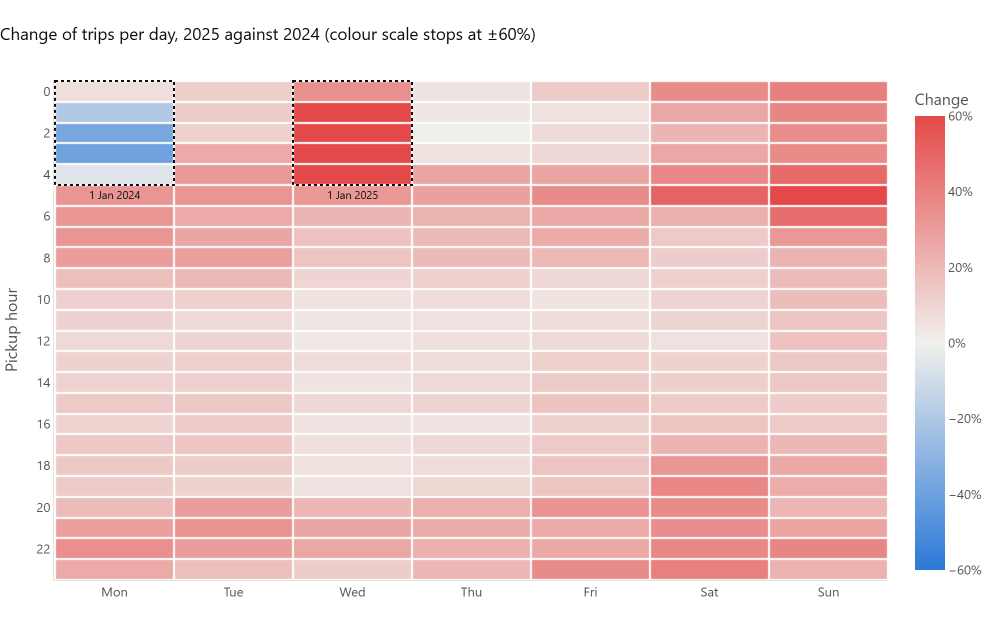
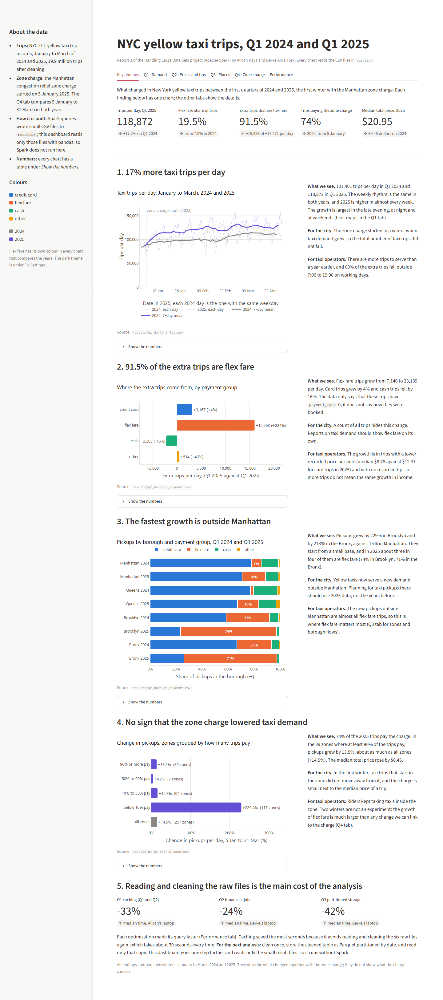

# NYC Taxi Spark Analysis

Laboratory project for the *Handling Large Data Sets* course (Project 2, Apache Spark). We use PySpark, the DataFrame API and Spark SQL to study about 20 million NYC yellow taxi trips, and we measure how much a few common Spark optimizations change the run time.

**Question:** how do demand, prices and tipping of NYC yellow taxi trips change by time and place in the first quarter of 2025 compared with the first quarter of 2024, and how much of this traffic is affected by the new Manhattan congestion relief zone charge?

The charge started on 5 January 2025, so the first quarter of 2025 is the first one with it in the data, and the first quarter of 2024 is the same season one year earlier without it. The full problem, objectives and cleaning rules are in [docs/analysis-plan.md](docs/analysis-plan.md).

## Status
| Report | Topic | Status |
|---|---|---|
| Report 1 | Spark environment and data preparation | done |
| Report 2 | Queries and optimizations | done |
| Report 3 | Visualization, dashboard and summary | done |

All three reports are finished. The report sources and build scripts are in `reports/`. The built Word and PDF files are not in the repository.

The task list with owners is in [docs/PLAN.md](docs/PLAN.md).

## Main findings
- Trips per day grew from 101,401 in the first quarter of 2024 to 118,872 in the first quarter of 2025 (+17.2%). The growth is larger outside working hours: from Monday to Friday, 07:00 to 18:59, trips grew by 11.1%, and in all other hours by 22.7%.
- Flex fare trips (`payment_type` 0) make up 91.5% of the extra trips. They grew from 7,146 to 23,139 per day, while card trips grew by 4% and cash trips fell by 16%.
- Brooklyn (+228.7%) and the Bronx (+213.5%) grew fastest, from small bases. Most of the extra trips (about 13,600 of 17,500 per day) are still in Manhattan.
- 74% of the 2025 trips from 5 January pay the zone charge. From 5 January to 31 March, pickups grew by 13.5% in the 39 zones where at least 90% of the trips pay, about as much as in all zones (+14.5%). This shows no fall in demand in the charged zones in the first winter. Two winters cannot show what the charge caused.



## Dataset
- [NYC TLC Yellow Taxi Trip Records](https://www.nyc.gov/site/tlc/about/tlc-trip-record-data.page), January to March 2024 and 2025, one Parquet file per month, plus the zone lookup table (265 zones).
- 20,752,804 raw trips; 19,926,016 (96.0%) are left after cleaning.
- Columns, types, missing values and the effect of each cleaning rule are in [docs/data-dictionary.md](docs/data-dictionary.md).

## Queries
| Query | What it answers | Code |
|---|---|---|
| Q1 | Demand by day, hour and weekday, daily average per year | `src/hlds/demand.py` |
| Q2 | Duration, speed, price per mile and tips by hour and payment type | `src/hlds/prices.py` |
| Q3 | Busiest pickup and drop-off zones, borough flows, top routes, airport trips | `src/hlds/places.py` |
| Q4 | Trips that pay the congestion charge, by hour and zone, and their price | `src/hlds/congestion.py` |

Each query writes small aggregated CSV files to [results/](results/), so the charts for Report 3 can be drawn without running Spark again.

In Q4, the median total price of the trips that pay the congestion charge is 21.54 dollars, against 18.45 dollars for the trips that do not pay it.

## Spark MLlib extension
KMeans groups the 192 pickup zones with at least 10 trips per day by their weekly demand profile (168 hourly shares of 2025). We chose k = 3 with the silhouette score (0.396).

The three groups, with the change in their pickups per day from 2024 to 2025:
- all day: the Manhattan core and the airports (+12.7%)
- weekend nights (+32.4%)
- weekday mornings in residential zones (+101.5%)

The code is in `src/hlds/zone_groups.py` and `scripts/query_zone_groups.py`. The results are in `results/ml_*.csv`.

## Dashboard
The dashboard is a Streamlit app with Plotly charts. It reads only the small CSV files in `results/` with pandas, so Spark does not run. From the repository root:

```
streamlit run dashboard/app.py
```

It has six tabs: Key findings, Q1 Demand, Q2 Prices and tips, Q3 Places, Q4 Zone charge and Performance. Every chart shows its source file and a table of its numbers.

`python scripts/export_charts.py` saves the same charts as PNG files for the report (`reports/report3/figures/`).



## Optimizations
Each optimization was measured on the laptop of the team member who wrote it: one warm-up run and five measured runs, and the table shows the median. The two laptops are different, so the times should only be compared within a row.

| Optimization | Before | After | Median before | Median after | Change |
|---|---|---|---|---|---|
| O1 caching, Q1 and Q2 in a row | clean the raw files for every result | clean once and `cache()` | 281.5 s | 187.7 s | -33.3% |
| O2 broadcast join, zone joins of Q3 | sort merge join | `broadcast()` on the zone table | 24.5 s | 18.7 s | -23.6% |
| O3 storage, March 2025 daily summary | plain Parquet | Parquet partitioned by pickup date | 1.98 s | 1.15 s | -41.9% |

The times with the machine details are in `results/timings_alican.csv` and `results/timings_berke.csv`, and the final query plan of every run is in `results/plans/`.

## Running it
The setup of Python, Java 17 or newer and PySpark 4.2.0 on Windows is described step by step in [docs/environment.md](docs/environment.md). After that, from the repository root:

```
python scripts/download_data.py          # six monthly files and the zone table into data/raw/ (about 350 MB)
python scripts/query_demand.py           # Q1; query_prices.py, query_places.py and query_congestion.py work the same way
python scripts/query_borough_payment.py  # trips by year, pickup borough and payment group
python scripts/write_clean_tables.py     # cleaned copies for O3 in data/derived/
python scripts/query_zone_groups.py      # MLlib zone groups (reads the partitioned cleaned table)
python scripts/run_benchmarks.py --machine <label> [--case O1] [--repeats 5]
python scripts/export_charts.py          # charts as PNG for Report 3
streamlit run dashboard/app.py           # the dashboard
python reports/report3/build_report.py   # Report 3 as Word and PDF (needs Microsoft Word)
python -m unittest discover -s tests -t .
```

There are 171 tests in 21 files.

## Repository layout
```
dashboard/   Streamlit app and Plotly charts for Report 3
docs/        plan, analysis plan, data dictionary, environment guide, contributions
src/hlds/    Spark session, loading, cleaning, queries, optimizations, timing
scripts/     download, query, benchmark and profiling scripts
results/     aggregated query outputs, timings and saved query plans
reports/     report sources, build scripts and screenshots
tests/       unit tests, most of them on a small local Spark session
data/        local data files (not tracked)
```

## Team
| Member | Branch |
|---|---|
| Alican Kaya | `alican` |
| Berke Arda Türk | `berke` |

Work rules are in [CONTRIBUTING.md](CONTRIBUTING.md), and who did what for each report is in [docs/contributions.md](docs/contributions.md).
