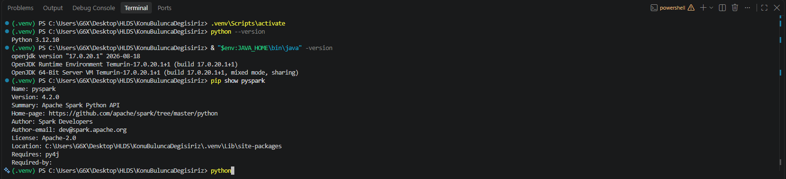
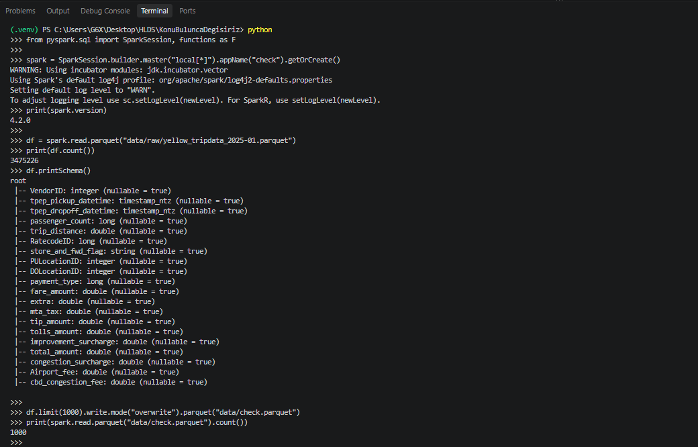
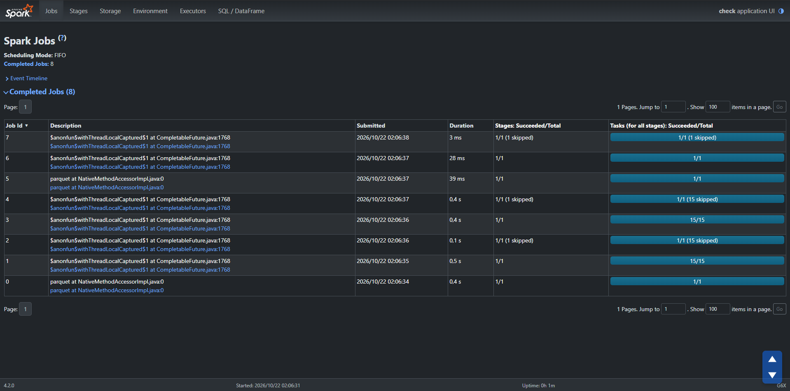
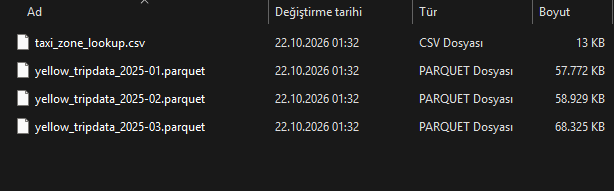
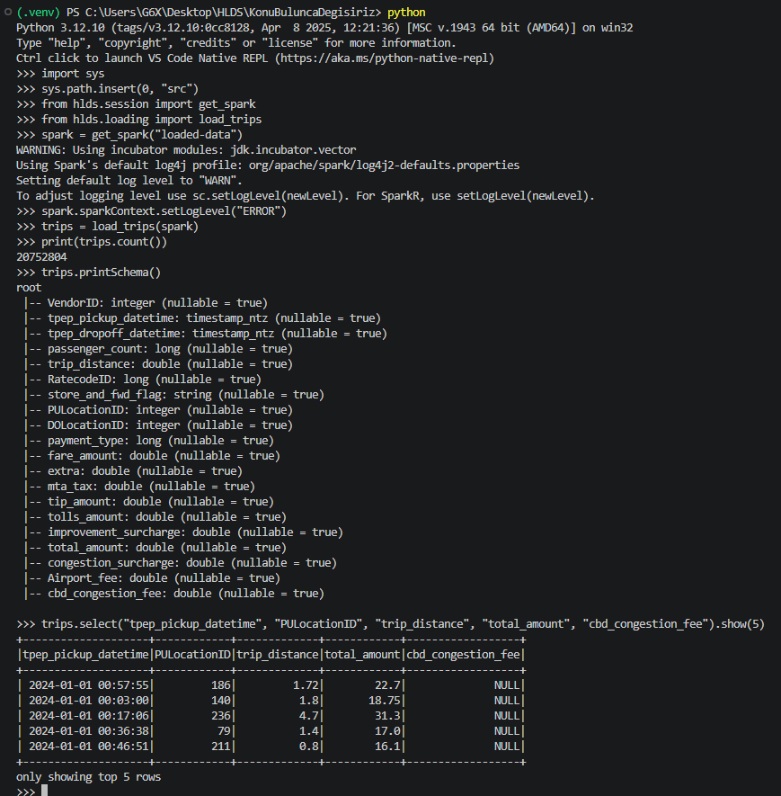

# Report 1: sections by Berke

These sections go into the final Report 1 document. The numbers come from the scripts named under each table, run on all six months.

## 4. Spark environment

*Written by Berke Arda Türk*

### 4.1 Why we run Spark locally

We run Spark in local mode (`local[*]`) on our own laptops. In this mode one Java process plays both the driver and the executors and uses every CPU thread as a worker. There is no cluster to install, and about 20 million rows still fit on a laptop because Parquet is compact and Spark reads only the columns a query needs. Local mode also has a limit that matters for Report 2: all threads share one machine and one block of memory, so we will not see the network costs of a real cluster when we measure the optimizations.

We use PySpark from pip, which already contains Spark, so we did not download Spark separately. The full setup guide with every command is in `docs/environment.md`.

### 4.2 Versions

Table 4.1. Software used on Berke's laptop

| Component | Version | Why |
|---|---|---|
| Python | 3.12 | supported by PySpark 4.2 |
| Java | 17 (Eclipse Temurin) | Spark 4.x needs Java 17 or newer |
| PySpark | 4.2.0 | latest release when we started; contains Spark 4.2.0 and the Hadoop 3.5.0 client |
| winutils | Hadoop 3.3.6 build | Windows only, needed to write files (Section 8.1) |

Source: `requirements.txt` and `docs/environment.md`.

The Python packages are pinned in `requirements.txt`, so both of us install the same versions. Alican's laptop already had Java 21 and Python 3.14, and we kept them because the same checks passed there. All Spark code creates its session through one helper, `get_spark` in `src/hlds/session.py`, so the settings below are the same in every script.



Figure 4.1. Python, Java and PySpark versions on Berke's laptop

Source: terminal output, commands in `docs/environment.md`.

### 4.3 Setup steps

1. Install Python 3.12 and Java 17, and set the user variable `JAVA_HOME` to the Java folder.
2. Create a virtual environment and run `pip install -r requirements.txt`.
3. On Windows, put `winutils.exe` and `hadoop.dll` into a folder, set `HADOOP_HOME` and add its `bin` folder to `PATH`.
4. Download the data with `python scripts/download_data.py`.
5. Run the check from `docs/environment.md`: it prints the Spark version, reads January 2025, writes and reads back 1,000 rows, and runs one Python UDF. The write tests winutils, and the UDF tests that Spark can start Python workers.



Figure 4.2. The check in the Python shell: version, row count, schema, write and read back, and Python UDF

Source: the check in `docs/environment.md`, step 6.



Figure 4.3. The Spark UI at http://localhost:4040 while the check runs

Source: Spark UI on Berke's laptop.

### 4.4 Machines

We measure on two different laptops, so we write down both. We will never compare timings between them, because each optimization in Report 2 is measured before and after on one laptop.

Table 4.2. Berke's laptop

| Item | Value |
|---|---|
| CPU | Intel Core i7-13650HX, 14 cores, 20 threads |
| RAM | 16 GB |
| OS | Windows 11 Pro |
| Spark | 4.2.0, local mode `local[*]`, driver memory 6g and session time zone UTC (`get_spark`), other settings default |
| Java | Temurin 17.0.20.1 |

Source: `docs/environment.md`.

Table 4.3. Alican's laptop

| Item | Value |
|---|---|
| CPU | Intel Core i7-14650HX, 16 cores, 24 threads |
| RAM | 32 GB |
| OS | Windows 11 Pro |
| Python | 3.14.7 |
| Spark | 4.2.0, local mode `local[*]`, driver memory 6g and session time zone UTC (`get_spark`), other settings default |
| Java | Microsoft OpenJDK 21.0.12.1 |

Source: `docs/environment.md`.

## 5. Loading the data

*Written by Berke Arda Türk*

### 5.1 Files

`scripts/download_data.py` puts the six monthly Parquet files and the zone table into `data/raw/`. The `data/` folder is never committed; anyone can create it again with this script.



Figure 5.1. The downloaded files in `data/raw/`

Source: file listing on Berke's laptop.

### 5.2 Reading the trips

`load_trips` in `src/hlds/loading.py` reads all six files at once (Appendix A.1). We had to decide how to combine them, because the 2024 files have 19 columns and the 2025 files have 20. We use Spark's `mergeSchema` option instead of reading each file and joining them with a union, for two reasons. It builds one scan over all files, which keeps the query plan simple for the optimizations in Report 2. And it fails with `CANNOT_MERGE_SCHEMAS` when a column has different types in two files, so a change in the source data cannot pass silently. A test in `tests/test_loading.py` checks this. For 2024, the column that does not exist comes back as null.



Figure 5.2. The loaded table: row count, schema and the first rows

Source: `load_trips` and `get_spark` in the Python shell.

The count is the 20,752,804 rows of Table 1.1. The first rows shown come from January 2024, so `cbd_congestion_fee` is `NULL` there, as we expected.

Table 5.1. Raw trip columns

| Column | Type | Missing in 2024 | Missing in 2025 |
|---|---|---|---|
| `VendorID` | integer | 0 | 0 |
| `tpep_pickup_datetime` | timestamp_ntz | 0 | 0 |
| `tpep_dropoff_datetime` | timestamp_ntz | 0 | 0 |
| `passenger_count` | long | 751,962 (7.87%) | 2,263,749 (20.22%) |
| `trip_distance` | double | 0 | 0 |
| `RatecodeID` | long | 751,962 (7.87%) | 2,263,749 (20.22%) |
| `store_and_fwd_flag` | string | 751,962 (7.87%) | 2,263,749 (20.22%) |
| `PULocationID` | integer | 0 | 0 |
| `DOLocationID` | integer | 0 | 0 |
| `payment_type` | long | 0 | 0 |
| `fare_amount` | double | 0 | 0 |
| `extra` | double | 0 | 0 |
| `mta_tax` | double | 0 | 0 |
| `tip_amount` | double | 0 | 0 |
| `tolls_amount` | double | 0 | 0 |
| `improvement_surcharge` | double | 0 | 0 |
| `total_amount` | double | 0 | 0 |
| `congestion_surcharge` | double | 751,962 (7.87%) | 2,263,749 (20.22%) |
| `Airport_fee` | double | 751,962 (7.87%) | 2,263,749 (20.22%) |
| `cbd_congestion_fee` | double | 9,554,778 (100.00%) | 0 |

Source: `scripts/profile_raw_data.py`.

The types are the same in all six files. We took the column names from the schema and not from the official dictionary, because they differ in one place: the dictionary writes `airport_fee`, and the files have `Airport_fee`. The times are `timestamp_ntz`, a date and time without a time zone, which turned out to matter (Section 8.3).

### 5.3 Reading the zone table

`load_zones` reads `taxi_zone_lookup.csv`, checks that the columns are the ones we expect and converts `LocationID` to an integer. CSV has no types, so without this step the id would be text. We checked three things that matter for the join in Report 2. All 265 `LocationID` values are distinct, so a join cannot multiply trips. No value is missing. And every `PULocationID` and `DOLocationID` in the six months is in the table, so no trip is lost in the join. Two rows are not real places: 264 (`Unknown`, `N/A`) and 265 (`N/A`, `Outside of NYC`). Spark reads `N/A` as text and not as a missing value, so Q3 has to treat these two rows on purpose.

## 7. Descriptive statistics

*Written by Berke Arda Türk*

All tables in this section describe the cleaned table, the output of `clean_trips`. `scripts/describe_trips.py` writes them to `results/descriptive_statistics.md`, where the longer versions are, including every column split by flex fare. Percentiles are approximate (`percentile_approx`), which is much cheaper than exact percentiles on 20 million rows and accurate enough here. Amounts are in US dollars and distances in miles.

### 7.1 Overview

Table 7.1. Size of the cleaned table

| Year | Trips | Days | Trips per day | Flex fare | `has_negative_part` |
|---|---|---|---|---|---|
| 2024 | 9,227,496 | 91 | 101,401 | 7.05% | 0.23% |
| 2025 | 10,698,520 | 90 | 118,872 | 19.47% | 2.95% |

Source: `scripts/describe_trips.py`.

We compare trips per day because 2024 was a leap year and its first quarter has one day more. Yellow taxi demand is about 17% higher per day in 2025. We cannot say why from this table alone, and it is one of the things Q1 and Q4 will look at. The share of flex fare trips grows from about one in fourteen to about one in five, which changes many of the averages below.

### 7.2 Numeric columns

Table 7.2. Numeric columns of the cleaned table per year

| Column | Year | Rows | Mean | Std. dev. | Min | P25 | Median | P75 | P99 | Max |
|---|---|---|---|---|---|---|---|---|---|---|
| `trip_distance` | 2024 | 9,227,496 | 3.29 | 4.30 | 0.01 | 1.04 | 1.74 | 3.24 | 19.90 | 99.77 |
| `trip_distance` | 2025 | 10,698,520 | 3.21 | 4.06 | 0.01 | 1.06 | 1.78 | 3.31 | 19.34 | 99.68 |
| `duration_minutes` | 2024 | 9,227,496 | 15.52 | 12.45 | 0.02 | 7.48 | 12.13 | 19.42 | 62.98 | 299.38 |
| `duration_minutes` | 2025 | 10,698,520 | 15.21 | 11.77 | 0.02 | 7.67 | 12.20 | 18.98 | 61.12 | 299.47 |
| `passenger_count` | 2024 | 8,474,869 | 1.35 | 0.83 | 1 | 1 | 1 | 1 | 5 | 9 |
| `passenger_count` | 2025 | 8,549,925 | 1.30 | 0.73 | 1 | 1 | 1 | 1 | 4 | 9 |
| `fare_amount` | 2024 | 9,206,634 | 18.71 | 16.91 | 0.00 | 9.30 | 12.88 | 20.50 | 72.00 | 999.00 |
| `fare_amount` | 2025 | 10,383,328 | 18.42 | 16.10 | 0.00 | 9.30 | 13.50 | 20.84 | 70.20 | 999.00 |
| `tip_amount` | 2024 | 9,206,634 | 3.35 | 3.88 | 0.00 | 1.00 | 2.72 | 4.20 | 17.19 | 999.99 |
| `tip_amount` | 2025 | 10,383,328 | 3.02 | 3.75 | 0.00 | 0.00 | 2.50 | 4.00 | 17.15 | 440.00 |
| `total_amount` | 2024 | 9,206,634 | 27.50 | 21.43 | 0.00 | 15.70 | 20.50 | 29.04 | 103.13 | 1,021.99 |
| `total_amount` | 2025 | 10,383,328 | 27.15 | 20.22 | 0.00 | 16.10 | 20.90 | 29.00 | 102.11 | 1,003.62 |
| `cbd_congestion_fee` | 2025 | 10,383,328 | 0.54 | 0.34 | 0.00 | 0.00 | 0.75 | 0.75 | 0.75 | 1.50 |

Source: `scripts/describe_trips.py`. The price columns leave out the `has_negative_part` rows. `duration_minutes` is the plain clock difference; Q2 corrects the trips across the New York summer time change.

A typical trip is short: half of all trips are under about 1.8 miles and 12 minutes in both years. The means are well above the medians because a small number of long trips pull them up, so we prefer medians when we compare groups. The maximum values also show what the limits of our cleaning rules leave in: distances just under 100 miles and durations just under 5 hours.

The two years look very similar on these columns. The mean of `total_amount` goes down slightly while its median goes up, so the table alone does not show whether prices rose or fell. Q2 and Q4 will need to compare the same kinds of trips. `passenger_count` has fewer rows because flex fare trips do not record it and we read 0 as not entered (Section 6.2).

### 7.3 Tips and the flex fare share

The mean tip seems to fall from 3.35 to 3.02 dollars, but the split by flex fare shows something else.

Table 7.3. Mean `tip_amount` by flex fare

| Year | All trips | Without flex fare | Flex fare |
|---|---|---|---|
| 2024 | 3.35 | 3.52 | 1.07 |
| 2025 | 3.02 | 3.55 | 0.44 |

Source: `scripts/describe_trips.py`.

Without flex fare the mean tip hardly changes. It falls overall because the share of flex fare trips, which have much lower tips, grows. This is why Q2 shows flex fare as its own group: an average over all trips would change only because the mix of trips changed.

### 7.4 Categories

Table 7.4. Payment type

| Payment type | 2024 trips | 2024 share | 2025 trips | 2025 share |
|---|---|---|---|---|
| flex fare | 650,271 | 7.05% | 2,082,527 | 19.47% |
| credit card | 7,192,328 | 77.94% | 7,398,293 | 69.15% |
| cash | 1,275,952 | 13.83% | 1,063,676 | 9.94% |
| no charge | 33,997 | 0.37% | 38,156 | 0.36% |
| dispute | 74,948 | 0.81% | 115,868 | 1.08% |

Source: `scripts/describe_trips.py`.

Table 7.5. Pickup borough

| Borough | 2024 trips | 2024 share | 2025 trips | 2025 share |
|---|---|---|---|---|
| Manhattan | 8,297,071 | 89.92% | 9,432,150 | 88.16% |
| Queens | 790,183 | 8.56% | 892,529 | 8.34% |
| Brooklyn | 87,288 | 0.95% | 283,730 | 2.65% |
| Bronx | 21,172 | 0.23% | 65,637 | 0.61% |
| Unknown | 29,268 | 0.32% | 21,706 | 0.20% |
| N/A | 2,152 | 0.02% | 1,660 | 0.02% |
| Staten Island | 179 | 0.00% | 894 | 0.01% |
| EWR | 183 | 0.00% | 214 | 0.00% |

Source: `scripts/describe_trips.py`.

Yellow taxis are mostly a Manhattan business: close to nine of ten pickups in both years. Queens comes next. It contains both JFK and LaGuardia, and Q3 will show how much of this is airport traffic. Brooklyn and the Bronx are small but more than double their share in 2025. Credit card and cash both lose share to flex fare.

### 7.5 The zone charge

From 5 January 2025 there are 10,352,428 trips in the cleaned table, and 7,662,245 of them (74.01%) have a `cbd_congestion_fee` above 0. So about three of four trips pay the charge. This is a high share, and it fits Table 7.5: most pickups are in Manhattan, and the zone is in Manhattan. Q4 will show where and when these trips happen.

### 7.6 `total_amount` and its parts

Before we chose `total_amount` as the price for Report 2, we checked whether it equals the sum of the amount columns.

Table 7.6. Rows where `total_amount` differs from the sum of its parts

| Year | VendorID | Flex fare | Rows | Differs | +2.50 | -2.50 | -3.25 |
|---|---|---|---|---|---|---|---|
| 2024 | 1 | False | 2,087,388 | 93.28% | 0.00% | 87.36% | 0.00% |
| 2024 | 1 | True | 112,421 | 94.13% | 94.10% | 0.00% | 0.00% |
| 2024 | 2 | False | 6,489,837 | 0.21% | 0.21% | 0.00% | 0.00% |
| 2024 | 2 | True | 537,284 | 90.92% | 90.92% | 0.00% | 0.00% |
| 2025 | 1 | False | 1,973,027 | 92.14% | 0.00% | 20.32% | 65.99% |
| 2025 | 1 | True | 325,123 | 82.41% | 82.22% | 0.00% | 0.00% |
| 2025 | 2 | False | 6,642,966 | 0.15% | 0.15% | 0.00% | 0.00% |
| 2025 | 2 | True | 1,756,539 | 83.41% | 65.56% | 0.00% | 0.00% |

Source: `scripts/describe_trips.py`. A missing part counts as 0. The full table also has VendorID 6, which has only 566 and 865 rows.

The differences are not random. Without flex fare, VendorID 2 almost always adds up. VendorID 1 is usually 2.50 or 3.25 too low, which are the amounts of the congestion surcharge and of the surcharge plus the zone charge, so it looks as if this vendor also counts them in `extra`. On flex fare rows the total is usually 2.50 higher than the parts, which looks like a congestion surcharge that is in the total although the column is empty. We did not confirm either explanation with the TLC. For our work the conclusion is simple: we use `total_amount` as the price, and we do not compare single parts such as `extra` between vendors.

## 8. Problems and solutions

*Written by Berke Arda Türk*

Some of these problems stopped our work, and others gave wrong numbers without any error. The second kind taught us the most, and we found most of them by looking at a summary table and asking why a number looked strange.

### 8.1 Spark could not write files on Windows

*Problem.* Spark read the data and computed results, but every `write` failed, and the log said `Did not find winutils.exe`. Spark writes local files through Hadoop's file system layer, and on Windows this layer needs two native helpers that are not part of the official Hadoop release.

*Solution.* We put `winutils.exe` and `hadoop.dll` from the Hadoop 3.3.6 build of the `cdarlint/winutils` repository on GitHub into a folder and set `HADOOP_HOME`. There is no build for Hadoop 3.5 yet, but 3.3.6 worked with the 3.5.0 client inside PySpark. These files are a community build and not an official Apache release, so we were careful: we compared their SHA-256 hashes between our two laptops, and they were identical, and we scanned them with VirusTotal (0 of 71 engines for `winutils.exe`, 1 of 71 for `hadoop.dll`).

### 8.2 Python UDFs failed and Spark used the wrong Java

*Problem.* `count()` worked, but a Python UDF failed with `Python was not found`. Spark workers look for `python3`, which on Windows opens the Microsoft Store shortcut. Separately, on one attempt the session did not start at all: `UnsupportedClassVersionError ... class file version 61.0`, after which Python waited forever. `JAVA_HOME` was not set, so Spark found an old Java 8 on `PATH`.

*Solution.* `get_spark` sets `PYSPARK_PYTHON` to the current interpreter before it creates the session, so no script has to remember it. We set `JAVA_HOME` to Java 17; Spark uses it no matter what else is on `PATH`.

### 8.3 Negative durations and the time zone

*Problem.* In our first summary table the shortest `duration_minutes` was -58 minutes, although we had just dropped every row with a drop-off before its pickup. There were 511 such rows in 2024 and 1,062 in 2025, all on 31 March 2024 and 30 March 2025. These are the nights when summer time starts in Europe. `F.timestamp_diff` converts `timestamp_ntz` to the session time zone first, and by default this is the time zone of the laptop. In Central Europe the hour from 02:00 to 03:00 does not exist on those nights, so a New York trip that starts at 02:30 got a wrong start time. No error appeared, and the result depended on whose laptop ran the code.

*Solution.* Alican set the session time zone to UTC in `get_spark`, and added a test with a trip in that hour. With UTC no duration is negative. The counts of our cleaning rules did not change, but Q2 would have got wrong speeds.

*A related effect.* New York has its own summer time change, on 10 March 2024 and 9 March 2025. The files contain clock times, so 2,360 trips across that hour look exactly one hour too long. Alican checked this with `scripts/check_summer_time.py`, and Q2 corrects these trips.

### 8.4 Out of memory on the laptop with more threads

*Problem.* `scripts/describe_trips.py` finished on the 20 thread laptop with 4 GB of driver memory but stopped with `OutOfMemoryError` on the 24 thread laptop. In local mode all threads share the driver memory, so more threads probably need more memory at the same moment, although we did not study the exact cause.

*Solution.* We raised the driver memory to 6 GB in `get_spark`. The script then finished on both laptops. The counts and means did not change, and 6 GB still fits on our 16 GB laptop. Because the setting is in one place, both laptops use the same value.

### 8.5 A misleading average for flex fare trips

*Problem.* Flex fare rows seemed to be much longer trips: their mean distance in the raw data was 11.69 miles in 2024 and 17.86 in 2025, against about 3.3 on the other rows. But their median was only 2.08 and 2.17 miles. The mean was pulled up by a few hundred impossible values: 119 and 401 flex fare rows are over 1,000 miles, and the largest is 320,136 miles.

*Solution.* We looked at medians and percentiles and not only at means, and we added a limit of 100 miles. It removes only 800 rows in the six months. Up to 100 miles the mean for flex fare rows is 2.85 and 3.01 miles, close to the other rows.

### 8.6 Negative amounts that were not refunds

*Problem.* Our first rule dropped every row with a negative amount. When we counted its effect per year, it removed 3.64% of 2024 and 7.03% of 2025. A rule that treats the years so differently could change the comparison by itself, so we looked closer. On the other rows a negative amount almost always comes with a negative total. On flex fare rows it usually does not: 21,017 rows in 2024 and 350,331 in 2025 have a negative part and a positive total, mostly a negative `fare_amount`.

*Solution.* We drop only negative totals and mark the other rows with `has_negative_part`. They stay in the demand counts and are left out of the price queries (Section 6.4). We also drop trips of 0 seconds. Together the rules now remove 3.43% and 4.46%. The difference is smaller, but it did not disappear, so we keep it in mind for Report 2. Spark 4 also stops with an error on a division by zero, which these 0 second trips would have caused in a speed calculation, so Q2 uses `try_divide`.

### 8.7 Two extreme amounts

*Problem.* The standard deviation of `total_amount` in 2025 was more than ten times that of 2024 (271.82 against 21.43). The reason was two rows: 863,380.37 and 132,555.41 dollars for trips under 3 miles. They raised the 2025 mean from 27.15 to 27.25 dollars. That looks small, but it is more than a quarter of the difference between the years.

*Solution.* We drop a `total_amount` over 2,000 dollars. The raw data has 13 such rows, and the other rules drop 11 of them anyway, so this rule removes only these two. The next largest amount is 1,021.99 dollars, so the limit is far from normal values.

## Appendix A. Code excerpts

*Written by Berke Arda Türk*

The full code is in the repository. These excerpts show the main steps, from loading to statistics.

### A.1 Loading

`get_spark` gives every script the same session settings. `load_trips` reads the six files as one table. `mergeSchema` keeps `cbd_congestion_fee`, which is null for 2024, and fails if a type differs between files.

```python
def load_trips(spark, files=None):
    paths = [str(path) for path in (files or trip_files())]
    # The 2024 files have no cbd_congestion_fee. Merging keeps the column, null for 2024, and fails if a type differs.
    return spark.read.option("mergeSchema", "true").parquet(*paths)


def load_zones(spark, path=ZONE_LOOKUP_FILE):
    zones = spark.read.option("header", "true").csv(str(path))
    if zones.columns != ZONE_COLUMNS:
        raise ValueError(f"unexpected zone columns: {zones.columns}")
    return zones.withColumn("LocationID", F.col("LocationID").cast("int"))
```

### A.2 Invalid rows

Each rule is a named condition, so `scripts/profile_cleaning.py` can count every rule with the same code that drops the rows. This is how we measured a rule per year before we used it.

```python
def invalid_row_rules():
    pickup = F.col("tpep_pickup_datetime")
    dropoff = F.col("tpep_dropoff_datetime")
    distance = F.col("trip_distance")
    in_period = reduce(or_, [
        (pickup >= F.lit(start).cast("timestamp_ntz")) & (pickup < F.lit(end).cast("timestamp_ntz"))
        for start, end in VALID_PERIODS
    ])
    return {
        "outside_period": ~in_period,
        "dropoff_before_pickup": dropoff < pickup,
        "zero_duration": dropoff == pickup,
        "over_time_limit": F.timestamp_diff("SECOND", pickup, dropoff) > MAX_TRIP_HOURS * 3600,
        "distance_zero_or_below": distance <= 0,
        "distance_over_limit": distance > MAX_TRIP_MILES,
        "negative_total": F.col("total_amount") < 0,
        "total_over_limit": F.col("total_amount") > MAX_TOTAL_AMOUNT,
    }


def drop_invalid_rows(trips):
    return trips.filter(~reduce(or_, invalid_row_rules().values()))
```

### A.3 Marking rows and the full cleaning

`coalesce` matters here. A comparison with a missing value gives null, and without `coalesce` the flag would be null for the flex fare and 2024 rows.

```python
def add_negative_part_flag(trips):
    # On flex fare trips fare_amount can be negative while the total is positive. These are not refunds, so the
    # trips still count for demand, but price queries should leave them out. A missing amount is not a negative one.
    has_negative_part = reduce(or_, [F.coalesce(F.col(column) < 0, F.lit(False)) for column in AMOUNT_COLUMNS])
    return trips.withColumn("has_negative_part", has_negative_part)


def clean_trips(trips):
    valid_trips = drop_invalid_rows(clean_missing_values_and_types(trips))
    return drop_duplicate_rows(add_negative_part_flag(valid_trips))
```

### A.4 Statistics

We build one aggregation for all columns instead of running one job per column, so Spark scans the table only once. Price columns get a condition that leaves out the `has_negative_part` rows.

```python
def column_statistics(column, include):
    value = F.when(include, F.col(column))
    percentiles = F.percentile_approx(value, list(PERCENTILES.values())).alias(f"{column}|percentiles")
    return [
        F.count(value).alias(f"{column}|rows"),
        F.sum((include & F.col(column).isNull()).cast("long")).alias(f"{column}|missing"),
        F.avg(value).alias(f"{column}|mean"),
        F.stddev(value).alias(f"{column}|stddev"),
        F.min(value).alias(f"{column}|min"),
        F.max(value).alias(f"{column}|max"),
        percentiles,
    ]
```
