# Report 3: sections by Alican

## 1. Introduction

*Written by Alican Kaya*

This is the third report of laboratory project 2 of Handling Large Data Sets, the Apache Spark project. We work on the yellow taxi trip records of the NYC Taxi and Limousine Commission (TLC) for January to March 2024 and January to March 2025. In all three reports we ask the same question: how do demand, prices and tipping of NYC yellow taxi trips change by time and place in the first quarter of 2025 compared with the first quarter of 2024, and how much of this traffic is affected by the new Manhattan congestion relief zone charge, which started on 5 January 2025? The first quarter of 2024 is the same season one year earlier, and it has no charge.

We use one Parquet file for each month and the zone lookup table with 265 zones. The six files hold 20,752,804 raw trips (9,554,778 in 2024 and 11,198,026 in 2025). After cleaning, 19,926,016 trips (96.0%) stay in the cleaned table.

This report builds on the first two:

- **Report 1.** The environment, loading the data, cleaning and descriptive statistics.
- **Report 2.** Four queries (Q1 demand over time, Q2 prices, speed and tips, Q3 places and routes, Q4 the zone charge) and three optimizations (O1 caching, O2 broadcast join, O3 partitioned storage), measured before and after. Every query saved its grouped result as a small CSV file in `results/`.

This report turns these result files into charts and a dashboard, explains what they show, sums up the whole project and adds the optional Spark MLlib extension. Section 2 follows the workflow from the raw files to the charts, with a short summary of Reports 1 and 2. Section 3 goes through every chart: what it shows, why we chose this chart type and what we learn from it. Section 4 describes the dashboard, and Section 5 gives the key findings and what they mean in practice. Section 6 lists the limitations and possible improvements. Section 7 is the optional extension, which groups the pickup zones by their demand over the week with KMeans in Spark MLlib. Section 8 has the conclusions and Section 9 the team contributions. Sections 1, 2, 3, 6 and 8 are by Alican Kaya, and Sections 4, 5 and 7 by Berke Arda Türk.

In short, taxi trips per day grew by 17.2% from Q1 2024 to Q1 2025, and 91.5% of the extra trips are flex fare trips. In the zones where almost every trip pays the zone charge, pickups grew about as much as in the whole city.

Two notes on reading the numbers. We compare trips per day, because the first quarter has 91 days in 2024 (a leap year) and 90 days in 2025. All times of day are the New York clock times of the trip files.

## 2. Workflow of the project

*Written by Alican Kaya*

The project follows one idea: Spark does the heavy work once, on about 20 million rows, and everything after that reads small files. Table 2.1 lists the steps from the raw files to the charts, with the code of each step and what it leaves behind. The charts are explained in Section 3 and the findings in Section 5, so we keep them out of this section.

Table 2.1. The steps of the project

| Step | What happens | Code | Output |
|---|---|---|---|
| 1. Download | The six monthly Parquet files and the zone lookup table from the TLC page | `scripts/download_data.py` | `data/raw/` (not in the repository) |
| 2. Load | Read the six files into one Spark DataFrame, check the columns, read the zone table | `src/hlds/loading.py` | DataFrame in memory |
| 3. Clean | Handle types and missing values, then drop invalid and duplicate rows; 96.0% stay | `src/hlds/cleaning.py` | Cleaned DataFrame, 19,926,016 rows |
| 4. Describe | Descriptive statistics and summary tables | `src/hlds/statistics.py`, `scripts/describe_trips.py` | `results/descriptive_statistics.md` |
| 5. Query | Q1 to Q4 with the DataFrame API and, where it reads better, Spark SQL | `src/hlds/demand.py`, `prices.py`, `places.py`, `congestion.py`; `scripts/query_*.py` | 15 CSV files in `results/` |
| 6. Optimize and measure | O1 to O3, one warm-up and five measured runs each, final plan saved | `src/hlds/caching.py`, `joins.py`, `storage.py`, `timing.py`, `benchmarks.py`; `scripts/run_benchmarks.py` | `results/timings_alican.csv`, `results/timings_berke.csv`, 8 plan files in `results/plans/` |
| 7. Chart and dashboard | pandas reads the CSV files, Plotly draws the charts, Streamlit shows them; Kaleido saves the same charts as PNG for this report | `dashboard/`, `scripts/export_charts.py` | The dashboard, 13 charts in `reports/report3/figures/` |
| 8. Report | The Markdown sections of both of us are joined into Word and PDF | `reports/report*/build_report.py` | The three reports |

Section 7 adds one more step to this list, the MLlib extension.

### 2.1 Setup, cleaning and Report 2 in short

We ran Spark 4.2.0 in local mode on two Windows 11 laptops, one for each of us, with driver memory 6g (details in Report 2, Table 2.1). Each optimization was measured on the laptop of the team member who wrote it, and we never compare times between the two laptops. At the start of Report 1 we wrote three shared helpers that every script uses: `src/hlds/session.py` creates the Spark session and sets its time zone to UTC, `paths.py` holds all file paths and `timing.py` does the measuring.

The cleaning rules of Report 1 keep the pickups between 1 January and 31 March. They drop trips with a drop-off at or before the pickup, durations over 5 hours, distances of 0 or less, or over 100 miles, negative totals, totals over 2,000 dollars and exact duplicates. Two kinds of unusual trips stay, and we mark them. Trips with a negative price part but a total that is not negative get `has_negative_part`. Flex fare trips (`payment_type` 0) get `details_missing` for their five missing fields. For the trip durations of Q2 we read the times as New York time and convert them to UTC, so trips across the summer time change are not one hour too long.

In Report 2 we ran the four queries and the three optimizations. Each optimization made its query faster: O1 caching from 281.5 to 187.7 seconds (-33%), O2 broadcast join from 24.5 to 18.7 seconds (-24%) and O3 partitioned storage from 1.98 to 1.15 seconds (-42%) (Report 2, Table 10.1). The three were measured on different queries and laptops, so their savings cannot be added up. The queries showed that trips per day grew from 101,401 to 118,872 (+17.2%) and that 91.5% of the extra trips are flex fare trips.

### 2.2 Why the charts read small files

The queries group about 20 million rows into small tables. The 15 result files have between 2 and 1,031 rows each. For example, the heat map of Q1 has 336 rows (2 years × 7 weekdays × 24 hours), and Q4 by pickup zone has 1,031 rows. The dashboard only reads these files, so it does not need Spark, and Spark is needed only when we want a new grouping. This is why step 7 does not use Spark.

### 2.3 Tests and teamwork

We have 163 tests in 20 test files in `tests/`, and we run them with `python -m unittest discover -s tests -t .`. The Spark tests use a few hand-made rows.

Each of us worked on our own Git branch (`alican` and `berke`). The finished tasks went to `main` through pull requests, 33 of them by 27 November. `docs/PLAN.md` lists the tasks with their owner, and `docs/contributions.md` lists the finished work. Section 9 is built from that file.

## 3. Charts and what they show

*Written by Alican Kaya*

This section explains 13 charts: three for Q1, two for Q2, three for Q3, two for Q4, one for the performance of the optimizations and the two charts that only the key findings tab has (Section 3.6). The pictures of those two charts are in Section 5 (Figures 5.1 and 5.2), so we do not repeat them here. All pictures come from the same chart functions as the dashboard (`scripts/export_charts.py`, Section 4). Section 4.2 explains the colours. For every chart we write what it shows, why we chose this chart type and what we learn from it. Times of day are New York time, and hours are pickup hours.

### 3.1 Q1 Demand over time

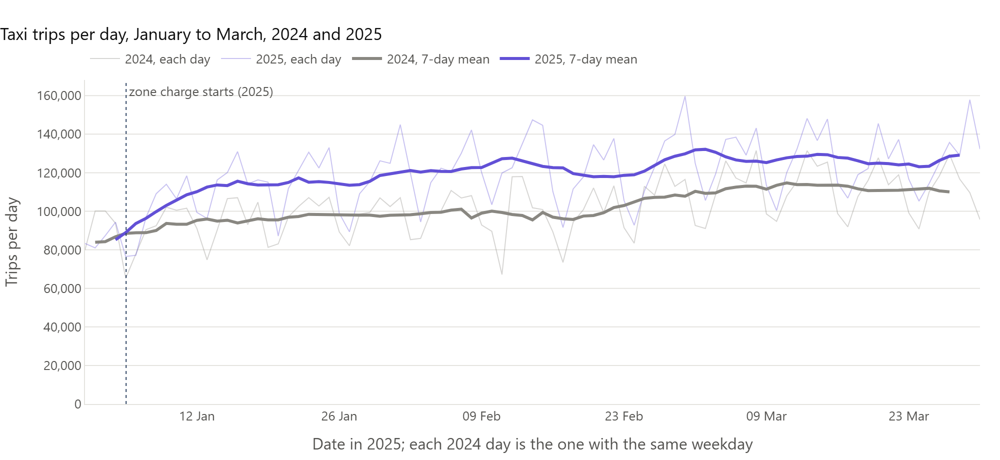

Source: `results/q1_daily_trips.csv`.

**What it shows.** Trips per day from 1 January to 30 March 2025. Next to each 2025 day we put the 2024 day with the same weekday. 1 January 2025 was a Wednesday, so we paired it with 3 January 2024, also a Wednesday. This gives 89 pairs. The thin light line shows each single day and the thick line the 7-day centred mean, which exists for 83 of the days because it needs three days on each side. A grey vertical line marks 5 January 2025, the start of the zone charge.

**Why this chart.** The data is a time series, so we use a line chart. We line up the years by weekday because with the same dates a 2024 Monday would stand next to a 2025 Wednesday, and the weekly wave is larger than the change between the years. The 7-day mean removes the weekly wave, so the distance between the two thick lines is easy to read.

**What we learn.** On 85 of the 89 days, 2025 has more trips than its partner. The 7-day mean of 2025 is above the one of 2024 on all of its 83 days but one, 4 January 2025 (85,228 against 86,754). The four days below their partner are 2 and 3 January 2025 (81,002 and 87,415 against 100,112 and 100,115), 6 January and 25 February. 2 and 3 January 2025 are still in the New Year week, while their 2024 partners come two days later in the calendar, so lining up by weekday moves the holiday.

The lowest day of 2025 is Sunday 5 January (76,531), and its partner, 7 January 2024, is the lowest day of 2024 (65,200). The gap between the years opens during January. The 7-day mean of 2025 is 0.4% above 2024 on 5 January, 13.4% on 10 January and 18.9% on 15 January, and later 24.1% on 15 February and 14.0% on 15 March. Over the first 14 pairs 2025 has 7.7% more trips, over the other 75 pairs 18.1% more. We did not check why the gap opens in January. This chart also cannot show what the charge did, because in 2025 only 1 to 4 January come before it, and they are holidays. Over the whole quarter, trips per day grew from 101,401 in Q1 2024 to 118,872 in Q1 2025 (+17.2%, `results/q1_daily_average.csv`). We cannot explain single high or low days, because the project has no weather or event data.

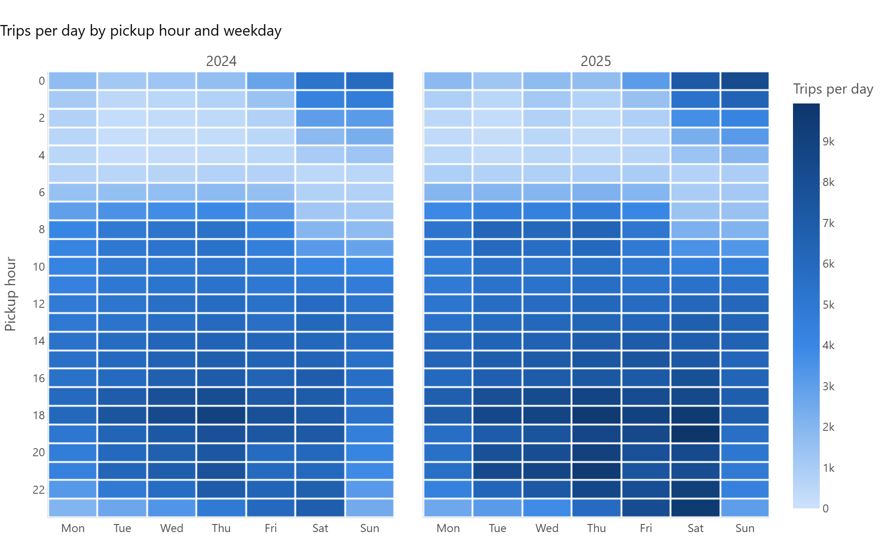

Source: `results/q1_hour_weekday.csv`.

**What it shows.** Two heat maps, one for 2024 and one for 2025. The rows are the pickup hours 0 to 23, the columns are the weekdays from Monday to Sunday, and the colour is the number of trips per day in that hour. Both maps use the same colour scale, from 0 to 9,925, the largest cell of both years.

**Why this chart.** A week has 7 × 24 = 168 cells with two ordered dimensions, and a heat map shows the whole week at once. With the same scale, the same colour means the same number in both years.

**What we learn.** The quietest cell in both years is Tuesday 03:00 (164 trips per day in 2024, 206 in 2025). The busiest cell is Thursday 18:00 in 2024 (8,991) and Saturday 19:00 in 2025 (9,925). Working days have a morning peak at 08:00 (5,103 to 6,416 trips on Monday to Friday in 2025) that weekends do not have (2,251 on Saturday, 2,125 on Sunday). The nights after Friday and Saturday are busy: in 2025 Sunday 00:00 has 8,274 trips per day, against 1,806 on Monday 00:00.

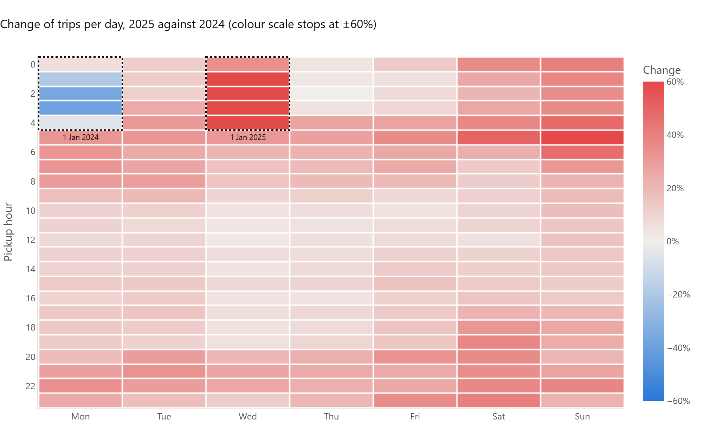

Source: `results/q1_hour_weekday.csv`.

**What it shows.** The change of trips per day from 2024 to 2025 in each of the 168 cells, in percent. The colours are diverging: red for a rise, blue for a fall and light grey at 0. The scale stops at -60% and +60%, and larger values get the end colour. Dotted boxes mark the 10 cells of New Year's night (1 January 00:00 to 04:59), on a Monday in 2024 and on a Wednesday in 2025.

**Why this chart.** Rises and falls need different colours, so we use a diverging scale. We set the limit at ±60% because otherwise the New Year cells (+156%) would set the scale and every other cell would look pale.

**What we learn.** Only 4 cells fell: Monday 01:00 to 04:59 (-5% to -39%). New Year's night 2024 is in them. The largest rises are Wednesday 01:00 to 04:59 (+92% to +156%), which is New Year's night 2025. A one-off check on the cleaned table showed that between 28% and 64% of the trips in these cells come from that one night; this check is not in `results/`. Without the 10 New Year cells, every cell grew, from +0.4% (Thursday 02:00) to +72% (Sunday 05:00). Monday to Friday from 07:00 to 18:59 grew by 11.1%, and all other cells, nights and weekends together, by 22.7%. Saturday and Sunday alone grew by 23.6%. So the new trips are mostly outside working hours. The Q2 charts show which payment group grew.

### 3.2 Q2 Prices, speed and tips

Both Q2 charts leave out trips with a negative price part (`has_negative_part`, almost all of them flex fare). So Q2 has 2.95% fewer trips than Q1 in 2025 (10,383,328 against 10,698,520) and 0.23% fewer in 2024. The borough chart in Section 3.3 and the findings in Section 5 read `q2_borough_payment.csv`, which keeps these trips, so their flex fare numbers are higher. Price per mile and the tip percentage are computed from `total_amount`, which in 2025 includes the zone charge (0.75 dollars on most paying trips, Section 5.4).

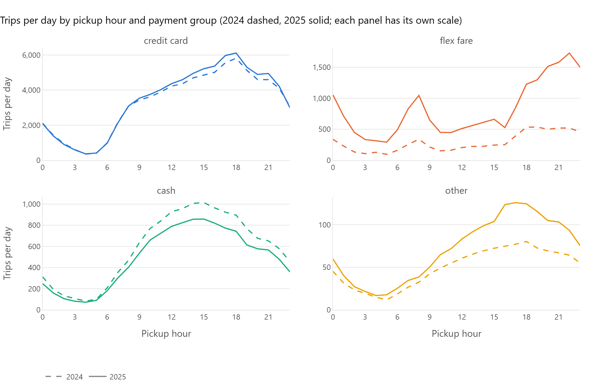

Source: `results/q2_by_hour_payment.csv`.

**What it shows.** Four small panels in a 2 × 2 grid, one for each payment group (credit card, flex fare, cash, other). Each panel shows trips per day by pickup hour, with one line per year. Every panel has its own y axis.

**Why this chart.** In one chart the flex fare lines of 2024 would lie flat under the card lines. With a small panel for each group and its own axis, the shape of every group is visible, and a shared axis would hide the small groups. When we compare panels, we read the axis numbers.

**What we learn.** Credit card trips grew by 4% over the day and peak at 18:00 in both years (5,817 and 6,113 trips per day). Flex fare grew from 6,917 to 19,637 trips per day, which is 2.84 times as many. With the trips that Q2 leaves out, it grew from 7,146 to 23,139, which is 3.24 times (Section 5.2). It grew in every hour, from +109% at 16:00 to +237% at 02:00. The peak moved from 19:00 in 2024 (535 trips) to 22:00 in 2025 (1,730). In 2025 flex fare is 41% of the trips at 04:00 and 30% to 33% from 23:00 to 03:59, but only 8% to 10% from 10:00 to 16:59. Cash fell by 16% and is lower in every hour (-10% to -23%).

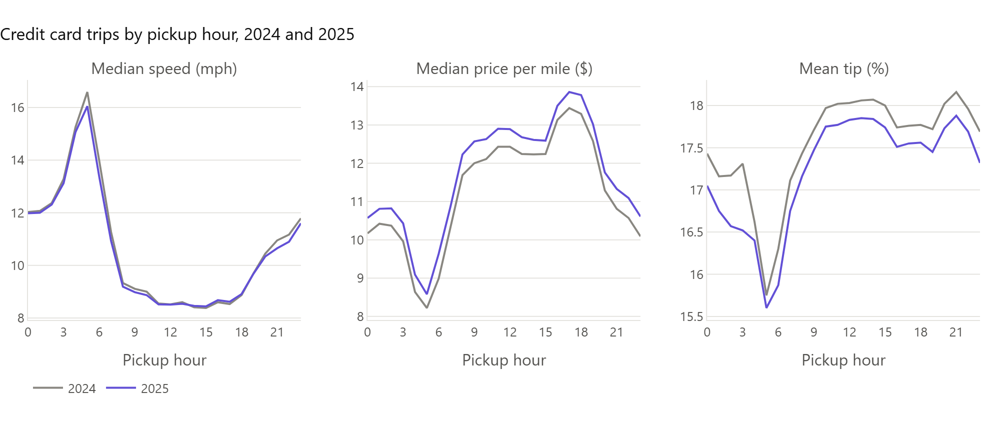

Source: `results/q2_by_hour_payment.csv`.

**What it shows.** Three panels by pickup hour for credit card trips: the median speed in miles per hour, the median price per mile in dollars and the mean tip as a percentage of the rest of the total amount. Each panel has one line per year. The y axes do not start at zero, so small differences look large, and we read the axis numbers.

**Why this chart.** We use card trips only, because only card payments record tips (`tip_amount` has no cash tips). Speed and price per mile are medians, because very short trips pull the means up (Report 2, Section 12.4). The tip is a mean, because the median tip is 20% in almost every hour of both years. That is a result in itself, but as a line it would be flat.

**What we learn.** Taxis are slowest at 15:00 (8.4 mph in both years) and fastest at 05:00 (16.6 mph in 2024, 16.0 in 2025). 2025 is slower in 19 of 24 hours, but in 12 hours the two years differ by 0.1 mph or less. The largest gaps are at 05:00 and 06:00 (0.5 and 0.6 mph). The price per mile is higher in every hour of 2025, by 0.35 to 0.65 dollars. It is highest at 17:00 (13.44 dollars in 2024, 13.86 in 2025) and lowest at 05:00 (8.22 and 8.58). The fast early morning is the cheapest per mile, but speed does not explain the whole pattern: 15:00 is about as slow as 17:00 and costs less per mile. We did not check why. Part of the rise between the years comes from the zone charge itself, because it is in `total_amount`. In Report 2 (Section 11.3) we estimated it roughly at 0.43 dollars per mile for the median trip, which is about the size of the rise. The mean tip is lower in every hour of 2025, by 0.15 to 0.79 percentage points. The charge is also in the base of the tip percentage, so part of this small fall can come from it too; we did not compute the tip without the charge. The median card tip is 20% in both years.

### 3.3 Q3 Places

Berke made the three Q3 charts, and this section interprets them.

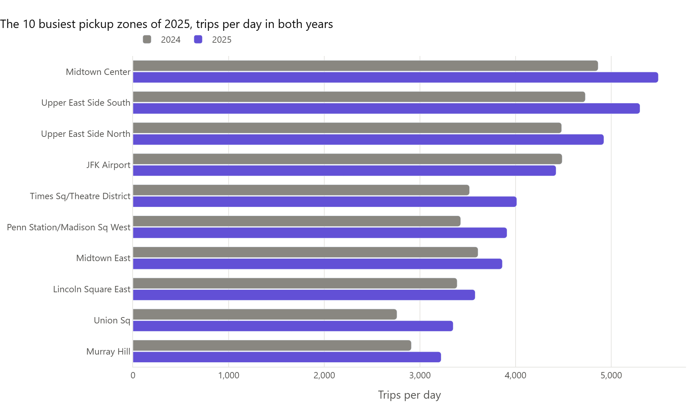

Source: `results/q3_pickup_zones.csv`.

**What it shows.** The 10 busiest pickup zones of 2025 as horizontal bars, with 2024 and 2025 side by side, in trips per day.

**Why this chart.** The bars are horizontal because the zone names are long, and grouped so that we can compare the two years zone by zone.

**What we learn.** Nine of the 10 zones are in Manhattan. Midtown Center is first in both years (4,863 and 5,492 trips per day). JFK Airport is the only one of the ten that fell (4,487 to 4,423), and it moved from 3rd to 4th place. LaGuardia Airport was 9th in 2024 and fell to 15th in 2025 (3,062 to 3,027), so it is no longer in the chart. Union Sq moved from 13th to 9th place (2,760 to 3,348, +21%). So the busiest zones grew in Manhattan, while both airports lost a few trips in a year when the city as a whole grew.

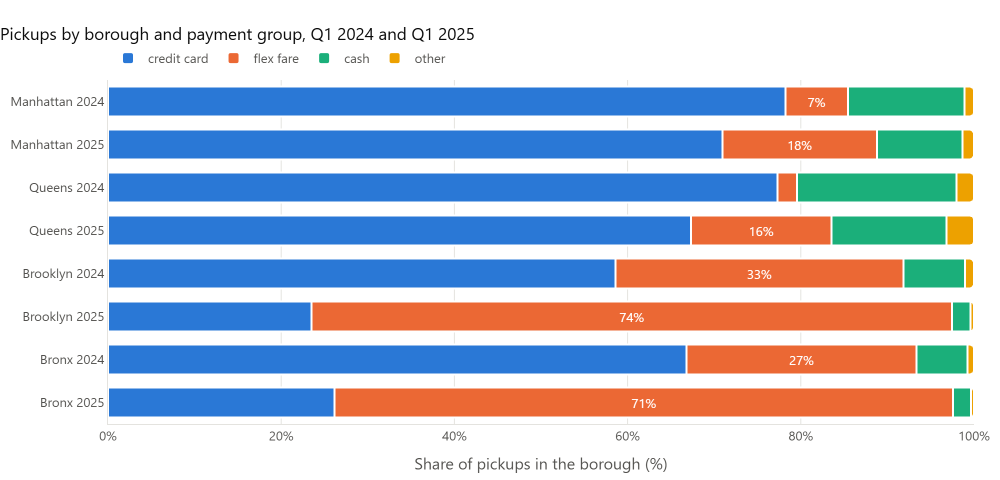

Source: `results/q2_borough_payment.csv`.

**What it shows.** For Manhattan, Queens, Brooklyn and the Bronx, the share of each payment group in the pickups of the borough. The stacked bars go from 0 to 100% for both years, and the flex fare part is labelled. The file keeps the trips with a negative price part, unlike the Q2 charts.

**Why this chart.** The boroughs differ a lot in size. In 2025 there are about 104,800 pickups per day in Manhattan, 3,150 in Brooklyn and 730 in the Bronx, so counts would hide the small boroughs. Shares make them comparable.

**What we learn.** The flex fare share went from 7.2% to 17.8% in Manhattan, from 2.3% to 16.2% in Queens, from 33% to 74% in Brooklyn and from 27% to 71% in the Bronx. The cash share fell in all four boroughs. The chart shows shares and not size: most flex fare trips are still in Manhattan (18,666 per day in 2025, against 2,331 in Brooklyn).

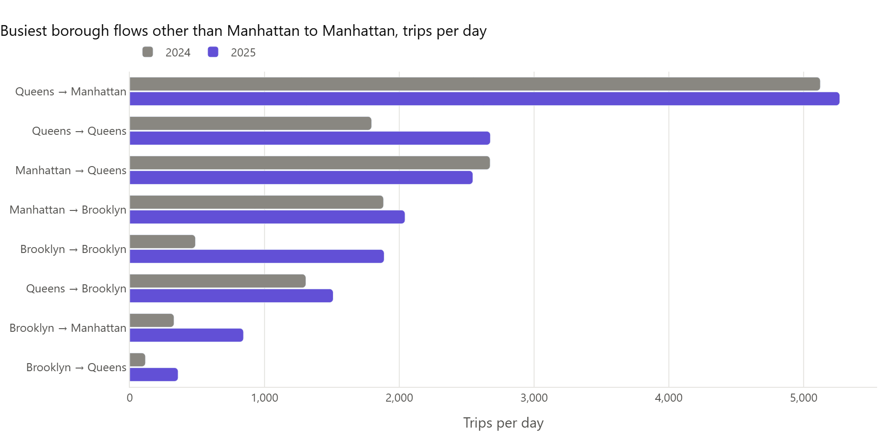

Source: `results/q3_borough_flows.csv`.

**What it shows.** The 8 busiest flows between boroughs (pickup to drop-off), other than Manhattan to Manhattan, as grouped horizontal bars in trips per day.

**Why this chart.** We leave out Manhattan to Manhattan because it is 84.6% of the trips in 2024 and 83.6% in 2025 (85,784 and 99,381 per day) and would make all other bars tiny. We give its numbers here instead.

**What we learn.** Brooklyn to Brooklyn grew from 487 to 1,887 trips per day (3.9 times) and Brooklyn to Manhattan from 328 to 844 (2.6 times). Queens to Queens grew by 49% (1,794 to 2,676). Queens to Manhattan grew by only 3% (5,124 to 5,268), and Manhattan to Queens fell by 5% (2,674 to 2,546). The airports have no chart, but `results/q3_airport_trips.csv` shows that trips from JFK went from 4,487 to 4,423, trips to JFK from 962 to 919 and trips from LaGuardia from 3,062 to 3,027. The flows with the fastest growth start in Brooklyn and Queens, and most of them stay outside Manhattan.

### 3.4 Q4 Zone charge

Berke also made the two Q4 charts, and this section interprets them. Both show the 2025 trips from 5 January to 31 March. A trip pays the zone charge when its record has a `cbd_congestion_fee` above 0, and 74% of these trips do. The median total amount is 21.54 dollars for the trips that pay and 18.45 dollars for the others (`results/q4_overview.csv`). The paying trips are also a little longer (median 1.80 miles against 1.64), so the gap between the two medians is not the charge alone.

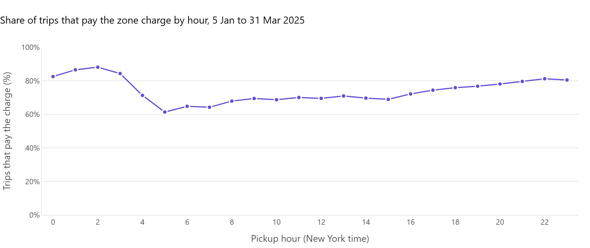

Source: `results/q4_by_hour.csv`.

**What it shows.** The share of trips that pay the zone charge by pickup hour, as one line. The y axis goes from 0 to 100%.

**Why this chart.** The hours are ordered, so we use a line. We use the full axis from 0 to 100% so that the change between hours does not look larger than it is.

**What we learn.** The share is lowest at 05:00 (61%). It is 64% to 68% from 06:00 to 08:59 and 69% to 71% from 09:00 to 15:59. From 16:00 (72%) it rises, and from 22:00 to 02:59 it is about 80% to 88%, with the highest value at 02:00 (88.1%). We did not check why the share is higher at night.

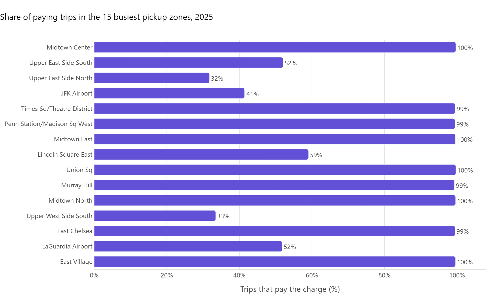

Source: `results/q4_by_pickup_zone.csv`.

**What it shows.** The 15 busiest pickup zones of 2025 (from 5 January) as horizontal bars. The length of a bar is the share of trips that pay the charge, and the share is written on each bar.

**Why this chart.** We compare separate zones, so we use bars, and they are horizontal because the zone names are long.

**What we learn.** Nine of the 15 zones have a share of 99.3% to 99.6% (the labels round them to 99% and 100%), among them Midtown Center and Union Sq. Almost every trip from these zones pays, so they look like zones inside the charge area; we did not check the zone borders on a map. In the other zones a large part of the trips does not pay, which fits zones outside the area where only the trips that go into it pay: Lincoln Square East 59%, Upper East Side South 52%, LaGuardia Airport 52%, JFK Airport 41%, Upper West Side South 34% and Upper East Side North 32%.

### 3.5 Performance of the optimizations

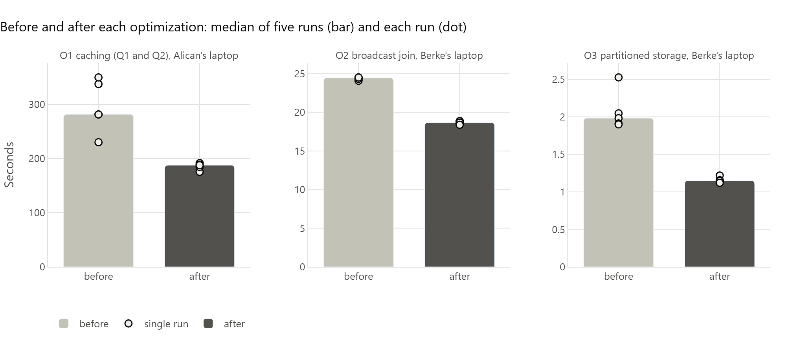

Sources: `results/timings_alican.csv` and `results/timings_berke.csv`.

**What it shows.** One panel for each optimization (O1, O2, O3). A bar shows the median of the five measured runs before and after, and a dot shows every single run. Before is light grey and after is dark grey.

**Why this chart.** The bars give the result and the dots show the spread, so a reader can see whether the change is larger than the noise. The panels have their own axes, because the slowest case takes more than a hundred times as long as the fastest (280 seconds against 2 seconds). O1 ran on Alican's laptop and O2 and O3 on Berke's, so we compare before and after inside a panel and never one panel with another.

**What we learn.** Every optimization made its query faster (Table 3.1, from Report 2, Table 10.1).

Table 3.1. Medians before and after

| Optimization | Laptop | Before (s) | After (s) | Change |
|---|---|---|---|---|
| O1 caching | Alican | 281.5 | 187.7 | -33% |
| O2 broadcast join | Berke | 24.5 | 18.7 | -24% |
| O3 partitioned storage | Berke | 1.98 | 1.15 | -42% |

In every panel the slowest run after the change is faster than the fastest run before it: 191.7 seconds against 230.1 for O1, 18.9 against 24.1 for O2 and 1.22 against 1.90 for O3. So the change is not noise. O1 before caching has a wide spread, from 230.1 to 349.9 seconds, and after caching the runs are between 175.6 and 191.7 seconds. The runs of O2 and O3 are close together.

The percentages hide how much time each change saves. Caching saves the most, about 94 seconds per run, because the five results of Q1 and Q2 no longer read and clean the six raw files again (Report 2, Section 7.3). The broadcast join saves about 6 seconds, because Spark sends the small zone table to every task instead of shuffling the trip table (Report 2, Section 8.3). Partitioned storage has the largest percentage but saves only 0.83 seconds, because a query on one month already runs fast and now reads only that month's folders (Report 2, Section 9.3).

Alican's laptop has an Intel Core i7-14650HX with 24 threads and 32 GB RAM, and Berke's an Intel Core i7-13650HX with 20 threads and 16 GB (Report 2, Table 2.1). On both we ran Spark 4.2.0 in local mode with 6g driver memory, from 8 to 12 November 2026.

### 3.6 The two charts of the key findings tab

Berke made these two charts for the key findings tab. Their pictures are Figure 5.1 (Section 5.2) and Figure 5.2 (Section 5.4).

**Where the extra trips come from, by payment group** (`results/q2_borough_payment.csv`, `results/q1_daily_average.csv`).

**What it shows.** One horizontal bar for each payment group: the extra trips per day in Q1 2025 against Q1 2024. The label gives the extra trips and the change in percent.

**Why this chart.** The question is how much each group adds to the growth, so the bars show the extra trips and not the totals. Bars can go below zero, so a group that shrank is visible on the other side of the zero line.

**What we learn.** Flex fare adds 15,993 trips per day (+224%), card trips 3,167 (+4%) and other 514 (+43%), while cash loses 2,203 (-16%). So the growth of all trips is almost only flex fare, 91.5% of it. Without this chart a reader would see the total rise and miss that one group makes it.

**Change in pickups, zones grouped by how many trips pay** (`results/q4_by_pickup_zone.csv`).

**What it shows.** The pickup zones are put into four groups by the share of their 2025 trips that pay the zone charge, and each bar is the change in pickups per day from 2024 to 2025, from 5 January to 31 March. A grey bar shows all zones together, and the label gives the number of zones.

**Why this chart.** If the charge pushed riders away, the zones where almost every trip pays should grow less than the others. One bar per group, next to the bar of all zones, makes this comparison direct.

**What we learn.** The 39 zones where at least 90% of the trips pay grew by 13.5%, about as much as all 257 zones (+14.5%). The 7 zones with 50% to 90% grew by 4.2% and the 94 zones with 10% to 50% by 15.7%. The 117 zones where less than 10% pay grew by 229%, but from a small base (834 to 2,746 pickups per day), and this one bar makes the axis long, so the other bars look short. We read the labels for them. The chart shows no clear fall in the charged zones, but it does not show what the charge caused (Section 5.4).

## 6. Limitations and possible improvements

*Written by Alican Kaya*

### 6.1 Limitations

- **Two winters and no comparison group.** We see what changed together with the zone charge, not what the charge caused (see also Section 5.6). Inside 2025 only 1 to 4 January come before the charge, and they are holidays, so we cannot compare before and after within one year either.
- **No statistical tests.** We describe the differences between two quarters and give no confidence intervals. Large percentages on small bases, such as the pickups in Brooklyn and the Bronx (about 3,150 and 730 per day in 2025), can change a lot with a few hundred trips.
- **Only yellow taxis.** We did not use green taxi or for-hire vehicle (app-based ride) data for the same months. We cannot tell whether the new flex fare trips came from other services.
- **Cleaning.** The cleaning rules keep 19,926,016 of the 20,752,804 raw trips (96.0%). Flex fare rows lose more than the others (13.52% in 2024 and 8.01% in 2025, against 2.56% and 3.56%), mostly because of distances of 0. So we count fewer flex fare trips than the raw files have, and more of them are left out in 2024 than in 2025, which makes the flex fare growth look a little larger than in the raw files.
- **Flex fare rows have no values in five fields.** These are `passenger_count`, `RatecodeID`, `store_and_fwd_flag`, `congestion_surcharge` and `Airport_fee`, and the values are missing in 2,263,749 raw rows of 2025 (20.22%). We only know that `payment_type` is 0, not how these trips are booked or paid. So we describe their growth and do not explain it.
- **Negative price parts.** Trips with a negative price part (315,191 flex fare rows in 2025) stay in the counts (Q1 and Q3) but are left out of the price queries (Q2 and Q4). Q2 therefore has 2.95% fewer trips than Q1 in 2025, its flex fare growth is lower (2.84 times instead of 3.24 times), and the flex fare prices describe only the trips without such a part.
- **The zone charge inside the prices.** In 2025 `total_amount` includes the zone charge, so price per mile and the tip percentage of the two years are not measured on the same base. We did not repeat them with `fare_amount`, the time-and-distance fare of the meter, which has the charge in its own column.
- **What "pays the charge" means.** A trip pays when its record has a `cbd_congestion_fee` above 0. We did not check the zone borders on a map, and we did not look into the 0.4% to 0.7% of trips that do not pay in the busiest zones that look inside the area.
- **Dropped negative totals.** When a negative total is dropped, the trip it seems to reverse stays. We match them by vendor, pickup and drop-off time, zones and the opposite total, and this matches 0.98% of the rows in 2024 and 1.39% in 2025 (`docs/analysis-plan.md`). So about 1% to 1.4% of the trips we count may have been reversed afterwards.
- **Tips only for card payments.** Cash tips are not in the data, so our tip results say nothing about cash trips.
- **Approximate medians.** We use `percentile_approx`. Between the two laptops, 19 of about 2,150 Q4 medians differed by at most 0.06 dollars, and the counts and shares were the same. We did not compare the medians with exact ones, so very small differences between the years, such as 0.1 mph in speed, should not be read as real.
- **The calendar.** 2024 has 91 days in the quarter (leap year) and 2025 has 90, so we compare trips per day. New Year's night falls on different weekdays and changes 10 cells of the heat map, and lining up by weekday moves the holiday week (2 and 3 January 2025).
- **No weather or event data.** We cannot explain single high or low days, so we only describe them.
- **Timings.** Each optimization was measured only on the laptop of the team member who wrote it, with five runs, and Spark ran in local mode on one machine. The O1 runs before caching spread over 120 seconds. We did not measure on a cluster, where reading, shuffling and memory would weigh differently, so the savings we report may not hold there.
- **Data quality.** The trip data comes from technology providers, and the NYC Taxi and Limousine Commission (TLC) makes no claims about its accuracy (data dictionary). We could not check the records against another source.
- **Fixed result files.** The dashboard reads fixed CSV files, so a new question needs a new Spark run.

### 6.2 Possible improvements

- **Other services.** Add green taxi and for-hire vehicle data of the same months, to see whether flex fare took trips from them.
- **More months.** Add the months after March 2025, and the same months of a later year, to see whether the growth continues once the charge is no longer new.
- **Weather and holidays.** Join a weather and holiday calendar to explain single days and to compare holidays on the same footing.
- **Better timings.** Measure every optimization on both laptops with more runs, and once on a small cluster.
- **Clean once.** Clean the raw files once and start every query from the partitioned cleaned table (O3).
- **Prices without the charge.** Repeat price per mile and the tip percentage with `fare_amount`, so that the two years are compared on the same base.
- **Forecast (optional).** Forecast trips per hour and zone with Spark MLlib.
