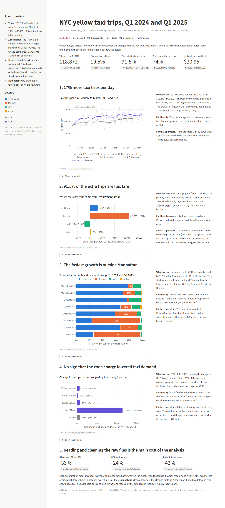
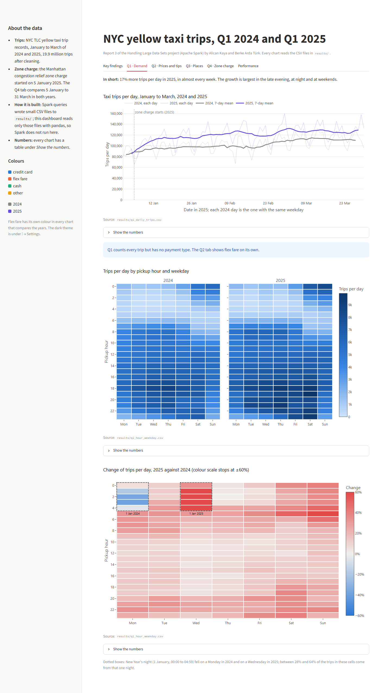
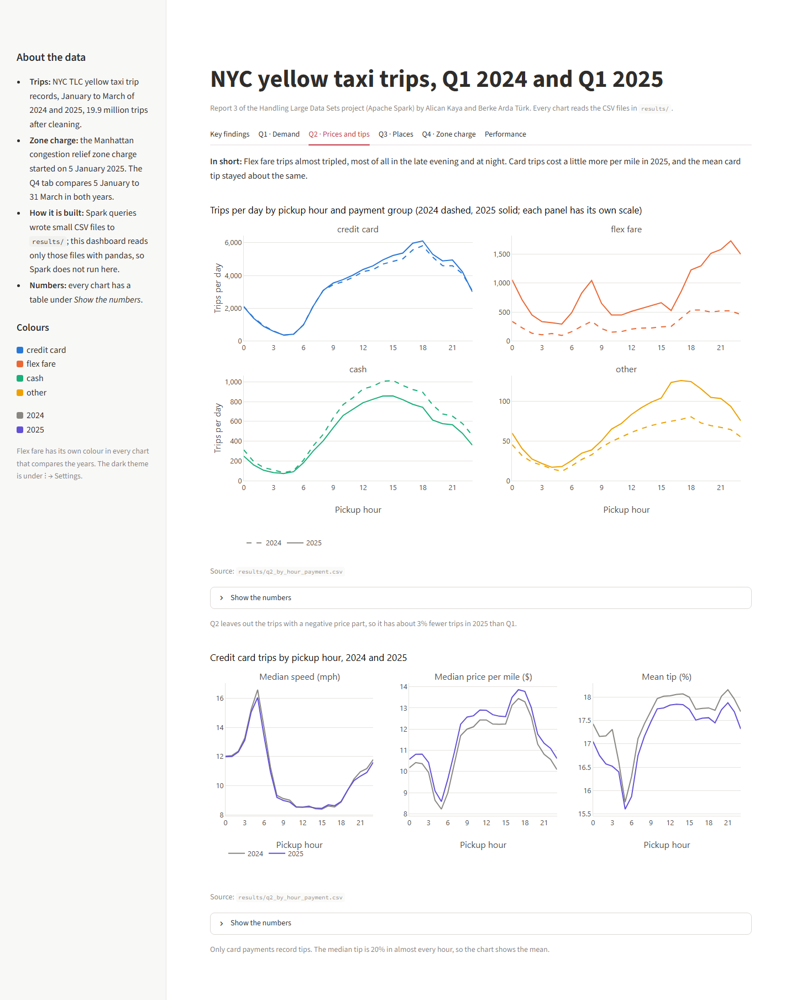
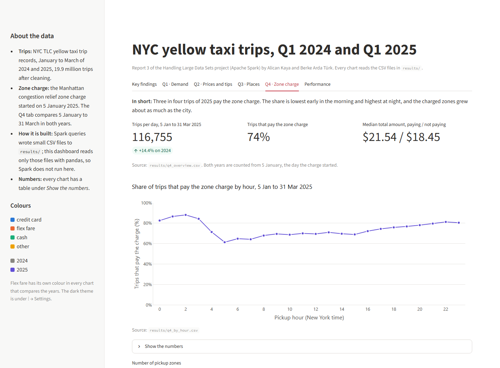
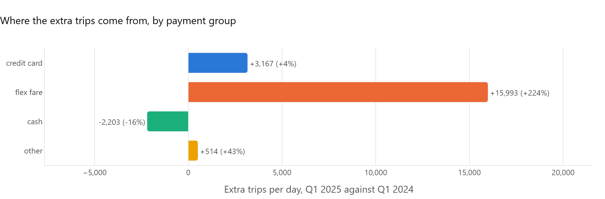
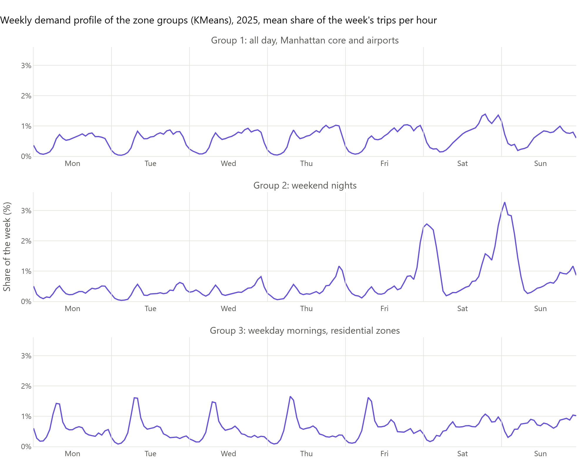

# Report 3: sections by Berke

## 4. Dashboard

*Written by Berke Arda Türk*

The dashboard puts all results of the project on one page. It is a Streamlit app with Plotly charts (Report 2, Section 13) and runs with one command from the root of the repository:

```
streamlit run dashboard/app.py
```

It reads only the small CSV files that the Spark queries wrote to `results/`, with pandas. Spark does not run, so the dashboard opens in a few seconds on any laptop with the packages of `requirements.txt`. The PNG pictures in this report are drawn by the same chart functions (`scripts/export_charts.py`), so the report and the dashboard always show the same charts.

### 4.1 Structure

Table 4.1. The tabs of the dashboard

| Tab | Question | Charts |
|---|---|---|
| Key findings | What changed between Q1 2024 and Q1 2025, and what does it mean? | Five summary numbers, one chart for each of the five findings below |
| Q1 · Demand | When do people take a taxi? | Trips per day with 2024 lined up by weekday; hour by weekday heat maps of trips and of the change |
| Q2 · Prices and tips | How do prices, speed and tips differ by hour and payment group? | Trips by hour for each payment group; speed, price per mile and tip of card trips by hour |
| Q3 · Places | Where do the trips start and end? | Busiest pickup or drop-off zones; pickups by borough and payment group; borough flows |
| Q4 · Zone charge | Which trips pay the zone charge, when and where? | Summary numbers; share of paying trips by hour and in the busiest zones |
| Performance | Did the optimizations help? | Before and after times of O1 to O3, with every measured run |

The first tab is new in this report. A reader who opens the dashboard sees the answer to the project question first and can go to the tab of a query for the details. Every other tab starts with one sentence that says what it shows, the "In short" line. The sidebar explains the data (period, cleaning, the start of the zone charge) and shows the colour of each payment group and year.

### 4.2 Design choices

- **The same colour for the same thing everywhere.** Credit card is blue, flex fare orange, cash aqua and other yellow, and 2024 is grey and 2025 violet. The colours are defined once in `dashboard/colors.py`, and both of us import them. We checked the payment colours with a colour blindness simulation in the light and the dark theme. Aqua and yellow have less contrast than 3:1 on white, so no chart relies on colour alone: every chart has a legend or labels, a hover text and a table.
- **Flex fare on its own.** Report 2 (Section 11.4) showed that most of the new trips are flex fare, so every chart that compares the years shows flex fare as its own bar, line or colour. A chart of all trips together would show the growth without showing where it comes from.
- **The numbers behind every chart.** Under each chart the dashboard names its source file and has a *Show the numbers* table. The summary numbers and the sentences of the key findings tab are computed from the same files (`dashboard/findings.py`), so they change with the results and cannot drift away from the charts.
- **Light and dark theme.** The charts take the colours of the Streamlit theme, and the dark theme has its own payment and year colours with enough contrast on a dark background.
- **A few controls, not many.** The Q3 tab can switch between pickup and drop-off zones and show 5 to 20 zones, and the Q4 tab can show 5 to 25 zones. We left out filters by date or borough, because each result file is already grouped for one question and a filter would only hide rows of it.

### 4.3 Screenshots

The screenshots show each tab in the light theme at a width of 1440 pixels, from the top of the page to the last chart. The sidebar is open in all of them; the *Show the numbers* tables are closed. They were taken with Playwright (Chromium) from the final dashboard, including the key findings tab.











The dashboard has its own tests (`tests/test_dashboard.py`, `tests/test_dashboard_q1_q2.py`, `tests/test_findings.py`). One of them runs the whole app on the real result files with Streamlit's test tool. It found an error that the single chart tests did not: the same chart on two tabs got the same internal ID, and Streamlit stopped drawing the tabs after it. Each chart of the key findings tab now has its own key.

## 5. Key findings and their practical meaning

*Written by Berke Arda Türk*

The project asked what changed in New York yellow taxi trips between the first quarters of 2024 and 2025, the first winter of the Manhattan congestion relief zone charge. Here we give the five main answers and what they mean for two groups of readers: the city, which plans transport and set the charge, and taxi operators and drivers, who decide where and when to work. The charts of each finding are in the key findings tab of the dashboard; the interpretation of every chart is in Section 3.

Table 5.1. The five summary numbers of the key findings tab

| Number | Value | Source |
|---|---|---|
| Trips per day, Q1 2025 | 118,872 (+17.2% on Q1 2024) | `results/q1_daily_average.csv` |
| Flex fare share of trips | 19.5% (7.0% in 2024) | `results/q2_borough_payment.csv` |
| Extra trips per day that are flex fare | 91.5% (15,993 of 17,471) | `results/q2_borough_payment.csv` |
| 2025 trips that pay the zone charge, from 5 January | 74% | `results/q4_overview.csv` |
| Median total price, from 5 January | 20.95 dollars (+0.45 on 2024) | `results/q4_overview.csv` |

### 5.1 More taxi trips, mostly outside working hours

There were 101,401 trips per day in Q1 2024 and 118,872 in Q1 2025, 17.2% more. The 7-day mean of 2025 is above the one of 2024 on every day but one in the first week of January. The growth is largest in the late evening, at night and at weekends: 69% of the extra trips per week fall outside 7:00 to 19:00 on Monday to Friday (`results/q1_hour_weekday.csv`).

- **For the city.** The zone charge started in a winter when taxi demand grew. Whatever the charge did, it did not make the total number of taxi trips fall.
- **For taxi operators.** There are more trips to serve than a year earlier, and most of the extra ones are in the evening, at night and at weekends, not in the busy working-day hours.

### 5.2 Nine in ten of the extra trips are flex fare



Flex fare trips grew from 7,146 to 23,139 per day and are 91.5% of the extra trips. Card trips grew by 4% and cash trips fell by 16% (Figure, `results/q2_borough_payment.csv`). These counts keep the trips with a negative price part, so they are higher than the Q2 numbers in Section 3.2. In 2025 the median recorded price per mile of a flex fare trip is 8.78 dollars, against 12.37 dollars for a card trip, and flex fare trips record no tip (`results/q2_by_payment.csv`). These prices come from Q2, which leaves out the trips with a negative price part, and they are computed from `total_amount`, which includes the zone charge for the trips that pay it, so they are a rough comparison (Section 6.1). The data only tells us that these trips have `payment_type` 0, not how they were booked or paid.

- **For the city.** A count of all trips hides this change. Any report on taxi demand, and any study of the zone charge, should show flex fare on its own, because one group of trips grew while the others stayed almost flat.
- **For taxi operators.** The growth is in trips with a lower recorded price per mile and no recorded tip. More trips therefore do not mean the same growth in income, and an operator who looks only at the number of trips would overestimate it.

### 5.3 The fastest growth is outside Manhattan

Pickups grew by 229% in Brooklyn and by 214% in the Bronx, against 15% in Manhattan (Report 2, Table 11.1). They start from a small base, about 3,150 and 730 pickups per day in 2025, and about three in four of them are flex fare (74% in Brooklyn, 71% in the Bronx). The airports did not take part in the growth: trips from and to JFK, LaGuardia and Newark stayed flat or fell slightly.

- **For the city.** Yellow taxis now serve a new demand outside Manhattan. Plans for taxi pickups there, for example taxi stands or pickup rules at busy places in Brooklyn, should use 2025 data and not the years before.
- **For taxi operators.** The new pickups outside Manhattan are almost all flex fare trips. This is the part of the city where flex fare matters most, and where a driver can find new trips that did not exist a year earlier.

### 5.4 No sign that the zone charge lowered taxi demand


Three in four trips of 2025 pay the zone charge. We grouped the pickup zones by the share of their 2025 trips that pay (Report 2, Table 6.3). In the 39 zones where at least 90% of the trips pay, almost all of them in Manhattan, pickups grew by 13.5%, about as much as all zones together (+14.5%). The median total price rose by 0.45 dollars, less than the charge of 0.75 dollars that most trips pay.

- **For the city.** In the first winter, taxi trips that start inside the charge area did not move away from it. For taxi riders the charge is small next to the median price of a trip (20.95 dollars), which fits with the demand we see.
- **For taxi operators.** Riders kept taking taxis inside the zone, so there is no reason in these numbers to avoid it.

This finding has a clear limit. Two winters are not an experiment, and the growth of flex fare is much larger than any change we can link to the charge. We can say that demand in the charged zones did not fall, but not what it would have been without the charge.

### 5.5 Reading and cleaning the raw files is the main cost of the analysis

Each of the three optimizations made its query faster: caching by 33%, the broadcast join by 24% and partitioned storage by 42% (Report 2, Table 10.1). Caching saved the most seconds, because it avoids reading and cleaning the six raw files again, which takes about 30 seconds every time.

- **For the next analysis of these data.** Clean the raw files once, store the cleaned table as Parquet partitioned by pickup date, and read only that copy. A query on one month then reads one sixth of the files.
- **For a dashboard.** Do not run Spark behind the charts. Our dashboard reads small result files and opens in seconds; Spark is needed only when a new question needs a new grouping.

### 5.6 What the findings do not show

All findings compare two winters, January to March of 2024 and 2025. They describe what changed together with the zone charge and do not show what the charge caused. We do not know how flex fare trips are booked, so we describe their growth and do not explain it. The limitations and the improvements we would make are in Section 6.

## 7. Optional extension: zone groups with Spark MLlib

*Written by Berke Arda Türk*

The queries of Report 2 compare places and hours one at a time. Here we ask a question that needs both at once: which pickup zones are busy at the same hours of the week? We group the zones by their weekly demand profile with KMeans from Spark MLlib. The code is in `src/hlds/zone_groups.py` and `scripts/query_zone_groups.py`, and the results are in `results/ml_zone_silhouette.csv`, `results/ml_zone_groups.csv` and `results/ml_group_profiles.csv`.

### 7.1 Method

- **Data.** The script reads the cleaned table partitioned by pickup date (O3, Report 2, Section 9), so the six raw files are not cleaned again. This follows our own advice from Section 5.5.
- **Profile of a zone.** For every pickup zone we count the trips of 2025 in each of the 168 hours of the week (Monday 00:00 to Sunday 23:00) and divide by the number of days of that weekday, as in Q1. Then we divide each of the 168 numbers by the zone's whole week. The profile therefore says *when* a zone is busy and not *how* busy it is. Without this step KMeans would group the zones by size, and Midtown would end up in a group of its own.
- **Which zones.** We keep the 192 zones with at least 10 trips per day in 2025. At fewer trips most of the 168 hours hold less than one trip, and the profile is mostly noise. Zones 264 and 265 are not places and are left out. The 192 zones still hold 99.6% of all trips of 2025 (118,390 of 118,872 per day).
- **Model.** Spark's `VectorAssembler` turns the 168 shares into one feature vector, and `KMeans` with a fixed seed groups the vectors. We number the groups by their trips, busiest first, so the numbers stay the same between runs.

### 7.2 Choosing the number of groups

We fitted KMeans for k = 2 to 8 and scored each result with the silhouette of `ClusteringEvaluator`. The silhouette is between -1 and 1 and is higher when the zones are close to their own group and far from the others.

Table 7.1. Silhouette for each number of groups

| k | 2 | 3 | 4 | 5 | 6 | 7 | 8 |
|---|---|---|---|---|---|---|---|
| Silhouette | 0.362 | **0.396** | 0.345 | 0.250 | 0.357 | 0.296 | 0.258 |

Source: `results/ml_zone_silhouette.csv`.

Three groups have the highest score, so we use k = 3. A silhouette of 0.40 means that the groups are real but overlap. Many zones lie between two groups, and the groups should be read as typical rhythms, not as sharp classes.

### 7.3 The three groups



Table 7.2. The three zone groups

| Group | Zones | Where | 2024 per day | 2025 per day | Change | Weekend share | Share 22:00 to 04:59 | Share Mon–Fri 07:00 to 09:59 |
|---|---|---|---|---|---|---|---|---|
| 1 All day, Manhattan core and airports | 73 | 50 Manhattan, 11 Brooklyn, 11 Queens, 1 Bronx | 88,225 | 99,440 | +12.7% | 32.7% | 18.9% | 10.0% |
| 2 Weekend nights | 16 | 7 Manhattan, 7 Brooklyn, 2 Queens | 9,763 | 12,926 | +32.4% | 55.2% | 45.8% | 6.6% |
| 3 Weekday mornings, residential zones | 103 | 36 Brooklyn, 32 Queens, 31 Bronx, 4 Manhattan | 2,991 | 6,025 | +101.5% | 32.9% | 17.0% | 19.6% |

Source: `results/ml_zone_groups.csv` and `results/ml_group_profiles.csv`; the shares are the group means of the 168-hour profiles. If trips were spread evenly over the week, the weekend would have 28.6%, the night hours 29.2% and the weekday mornings 8.9%.

- **Group 1, all day.** Midtown, the Upper East and Upper West Side, the business districts and both big airports. Demand rises during the morning, stays high all day and peaks on Saturday evening (19:00). JFK and LaGuardia are not a group of their own, as we first expected: their trips are spread over the day and the week in the same way as in the busy Manhattan zones.
- **Group 2, weekend nights.** East Village, West Village, Lower East Side, Williamsburg, Greenpoint and Bushwick. More than half of their trips start at the weekend and almost half between 22:00 and 04:59. The busiest hour is Sunday 01:00, the end of Saturday night, with 3.3% of the week's trips in one hour.
- **Group 3, weekday mornings.** 99 of the 103 zones are outside Manhattan, for example Central Harlem North, Astoria, Bay Ridge and the residential parts of Brooklyn and the Bronx. The busiest hours are 07:00 on working days. These are trips from home in the morning.

### 7.4 What the groups add

The groups grew at very different rates. Group 1, which holds 84% of the trips, grew by 12.7%. The weekend night zones grew by 32.4%, and the residential zones of group 3 doubled. This connects two findings that we had seen separately: most of the growth is outside Manhattan (Section 5.3) and at night and at weekends (Section 5.1). The fastest growth is in zones with a commuter rhythm on working-day mornings and in zones with a night-life rhythm at weekends. Both rhythms are outside the hours when Manhattan's core is busiest.

- **For the city.** The three groups need different service at different hours. Pickup rules or taxi stands planned for group 1 do not fit the morning peak of group 3 or the Saturday night of group 2.
- **For taxi operators.** The groups tell where to be at which hour: group 3 zones on working-day mornings and group 2 zones on Friday and Saturday nights, both of them parts of the city that grew fastest.

### 7.5 Limits of this extension

- The profiles come from 2025 only. A zone can have a different rhythm in 2024, so the growth of a group compares the same zones, not the same rhythm.
- KMeans with squared Euclidean distance looks for round groups of similar size and gives every zone to exactly one group. The silhouette of 0.40 shows that the borders between the groups are soft.
- The groups do not use payment type. We cannot say from them how much of the growth of group 3 is flex fare, although Section 5.3 shows that most new pickups outside Manhattan are.
- We did not check other distance measures or methods, such as cosine distance or a Gaussian mixture.
